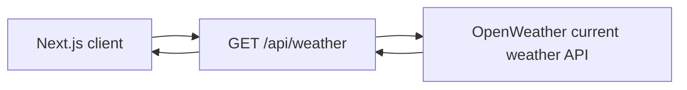

# Weather Dashboard

A responsive Next.js learning project that retrieves current weather through a
server-side API route. The browser requests the local route, so the OpenWeather
API key remains on the server.

## Current features

- Current temperature and weather condition for London
- Country and city display
- Light and dark themes
- Responsive weather card
- Server-only OpenWeather credential
- Basic loading and error states

## Architecture



## Local setup

Requirements: Node.js 20.19+ or 22+ and an OpenWeather API key.

```bash
npm ci
cp .env.example .env.local
```

Add your key to the ignored local environment file:

```dotenv
OPENWEATHERMAP_API_KEY=your_key_here
```

Start the development server:

```bash
npm run dev
```

Then open [http://localhost:3000](http://localhost:3000).

## Basic checks

```bash
npm run lint
npm run build
```

## Status and limitations

This is intentionally presented as an evolving Next.js learning project. The
current interface displays one default city; the planned search, multi-day
forecast, dynamic city routes, and persistence features are not implemented
yet. Provider availability and free-tier limits still apply, and this project
does not include production monitoring or a shared response cache.

See [PROJECT_REQUIREMENTS.md](PROJECT_REQUIREMENTS.md) for the learning roadmap.
